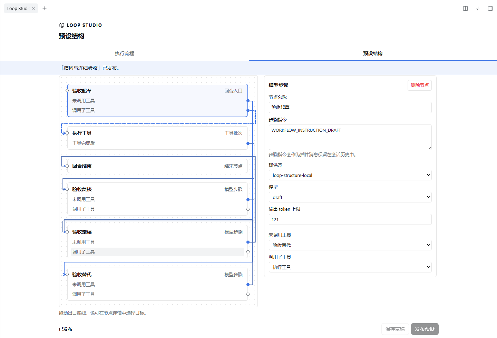

# 使用指南

## 打开 Loop Studio

从会话顶部或空白会话输入区上方的 **Loop** 打开。搭配支持入口整合的 RP Studio 时使用 **RP ▾ → 流程与模型**。右侧新增页签也可打开 **Loop Studio**。页面支持宿主侧栏拉宽和全屏，字体跟随 DSH 的设置。 [安装步骤](../README.md#安装)

## 复制并编辑原生预设

1. 进入 **预设结构**，在 **预设来源与副本** 选择内置或自定义的原始预设。顶部 **当前会话** 显示正在使用的预设，编辑选择器用来打开文档。
2. 点击 **创建可编辑副本**，填写 **预设名称** 和可选的 **说明**，再点 **创建副本**。副本继承来源的相对路径解析位置，并拥有独立的预设 ID。遇到无法确定解析位置的来源，页面会给出只读原因。
3. 打开 **组件**，搜索插件名、模块名或行 ID，也可展开分组浏览。用 **添加插件** 或 **添加分组** 选定模块和位置。添加插件可搜索目录，也可直接输入宿主能解析的模块名。
4. 选中组件后，在详情里改模块、启用状态或插件配置。**条件启用** 中填写的是停用条件，表达式为真时该行停用。树会另外显示上级分组的停用或条件状态。**高级设置** 可改行 ID 和 `inject`、`isolate`、`intercept` 等 Loader 选项。
5. 插件配置使用 JSON，高级选项使用 JSON 对象。点击 **应用组件修改** 让字段进入草稿。**上移**、**下移** 调整同级行的声明顺序，**移动到…** 可跨分组。**复制** 为复制的行与其子项分配新 ID。删除分组时可看到受影响项数，用 **撤销** 或 **重做** 调整修改。窄侧栏中可点 **返回组件列表**。

组件树中的 **声明顺序** 对应 Cordis Loader 的插件组成。每回合模型和工具的调度在 **执行编排** 中设置。使用自定义 Agent 驱动的副本可按宿主顺序执行。

## 连线编排模型与工具

在副本的 **执行编排** 点击 **启用连线编排**。起始图从 **模型请求** 开始。请求包含工具调用时，先经 **执行工具** 运行该批次，然后回到 **模型请求**。模型返回普通回答时直接到 **回合结束**。

选择节点可以改 **节点名称**、填 **步骤指令**、配置模型或编辑工具执行方式。模型默认 **继承宿主选择**，也可指定 DSH 已配置的提供方和模型，并按需设置推理强度与输出 token 上限。指令在会话中记录为 Loop Studio 的阶段消息。用 **设为回合入口** 指定本轮从哪个模型步骤开始。

在节点详情选择出口目标，也可以从图中的出口拖线或点选目标。

| 出口 | 连接目标与执行条件 |
| --- | --- |
| **未调用工具** | 每个模型步骤都要连接一个模型步骤或结束节点。模型完成普通回答后沿此出口继续。 |
| **调用了工具** | 模型步骤可以连接一个工具批次。此出口留空时，该步骤提供的工具列表为空。模型若仍发出调用，DSH 将调用结算为拒绝，编排随即结束。 |
| **工具完成后** | 工具批次必须连接一个模型步骤。DSH 先按会话规则审批并执行上一步发出的真实调用，再把结果交给下一模型步骤。批次可以 **继承宿主配置** 或 **依次执行**。 |
| 结束节点 | 到达后结束本轮的图调度。 |

每个节点都须从入口可达，并有通向结束节点的路径。环路受 **每回合模型请求上限** 约束，默认 32 个模型步骤，可设置为 1 至 256。一次原生模型步骤包含 DSH 自己的重试。到达上限后，需要继续的请求会被阻止。请求失败、取消、输出达到上限，或工具按宿主规则结束回合时，编排会终止。

连线编排需要 DSH 自带的 AgentLoop 和兼容的工具执行器。发布检查会报告驱动能力不足。工具执行器不兼容时，执行流程会在模型请求开始前给出原因。需要按预设自己的驱动执行时，点击 **恢复宿主顺序**，再发布该草稿。标题生成和参与插件的独立模型调用由各自模块调度。

## 试一次不同的请求顺序

以下示例使用带原生 AgentLoop 的副本，观察同一项任务如何经过不同的复核步骤。

1. 启用连线编排。选中 **执行工具** 并点击 **删除节点**。将入口 **模型请求** 改名为 **初稿**，在 **步骤指令** 填「根据用户要求写三条要点」。
2. 用 **＋ 模型步骤** 添加 **复核** 和 **定稿**。给 **复核** 填「检查初稿有无遗漏，给出修改建议」，给 **定稿** 填「结合初稿和修改建议，给出最终答复」。依次把三个模型节点的 **未调用工具** 出口指向 **复核**、**定稿** 和 **回合结束**。
3. 点击 **发布预设**，查看变更，点击 **确认发布**。在空白会话中选用这个副本，发送「把导出 PDF、逐页检查和附上源文件写成一份交付清单」。在 **执行流程** 中查看实际模型请求依次进入 **初稿 → 复核 → 定稿**。
4. 回到副本的 **执行编排**，添加 **备选复核**，指令填「逐条检查交付清单是否具体，找出一处可改进的表述」。将 **备选复核** 的 **未调用工具** 指向 **定稿**，将 **初稿** 的 **未调用工具** 改接到 **备选复核**，删除已脱离路径的 **复核**。
5. 再次发布，在另一空白会话选用副本并发同一条消息。执行记录应变为 **初稿 → 备选复核 → 定稿**。可对照两个会话的发布版本、请求顺序与所用模型。

若要在第一个图中加入工具，可保留起始图的 **执行工具**，将 **工具完成后** 指向 **复核**。在副本已准入相关工具的会话中发送一条需要该工具的消息。如果初稿步骤发起调用，实际记录会在 **初稿** 和 **复核** 之间显示工具批次及其结算。

## 保存、发布与选用

- **保存草稿** 将编辑存入当前 profile 的结构库。**发布预设** 会校验文档，展示相对来源或上次发布的变更。**确认发布** 会先保存本次修改，再由 DSH 加载组成。若加载失败，草稿仍可编辑，宿主会尝试恢复上次成功发布。
- 出现 **已加入 DSH 预设列表** 后，可点 **在当前空白会话中使用**，也可在 DSH 的预设选择器中选副本名称。已有回合的会话锁定预设选择。默认预设由 DSH 管理。
- 同一宿主进程内，已开始的会话继续使用已装配的版本。执行页显示 **当前会话 · 编排 vN**，有较新版本时还显示 **最新发布 vM**。新会话选用当前发布。完全重启 DSH 后，重新装配的会话使用其所选预设的当前发布。
- 草稿发生版本冲突时，编辑器保留本地修改。可先留存需要的内容，再点击 **重新载入草稿** → **丢弃修改并载入**，以已保存的最新版为基础重新编辑。

草稿与上次成功发布保存在 `$DSH_HOME/app-data/loop-studio/structures.<profile哈希>.json`。宿主路由策略位于同目录的 `policies.json`，会话路由归属位于 `routing-owners/`。未设置 `DSH_HOME` 时，默认使用 `~/.dsh`。退出 DSH 后可备份该目录。重新启用 Loop Studio 时，宿主从结构库恢复可加载的发布版本。

## 宿主流程的模型路由

保留宿主顺序的会话可在 **执行流程** 检查当前模型和实际请求。使用受支持的内置驱动时，启用模型接管后可为 **首个模型请求** 与 **后续模型请求** 分别选择提供方、模型及可用推理强度和输出上限。主动接入的插件也可开放自己的模型阶段，例如 RP 最后一步的 ST 迁移、热组装和最终正文。

会话的接管开关优先于预设默认。接管启用时，每个节点先使用会话配置，其次使用预设配置，最后使用宿主原选择。关闭会话接管会覆盖预设的开启设置。**恢复继承** 会删除当前保存范围的设置。切换范围前请保存需要保留的修改。

已装配的请求使用当时捕获的配置。下一次请求装配读取新的路由，实际记录中可核对提供方、模型和宿主报告的用量。已发布的编排使用对应版本的节点路由，更新时到 **预设结构 → 执行编排** 编辑并重新发布。

## 排查问题

- **入口没有出现**。检查安装命令对应正在使用的 `desktop` 或 `web` profile，完全退出并启动 DSH。再查看右侧新增页签，或 RP Studio 的 **RP ▾ → 流程与模型**。
- **插件发布失败**。按问题提示检查对应组件的模块名、声明位置、服务依赖和配置，再保存并发布。相对路径由来源预设的解析位置决定。
- **模型列表缺项或提供方失败**。在 DSH 中配置并验证对应提供方，再回到 Loop Studio 选择。提供方错误会记录到实际执行结果。
- **自定义驱动仅供观察**。在组件编辑中可创建和使用保持宿主顺序的副本。更改主流程的模型路由与连线需要兼容驱动。

反馈问题时可提供 DSH 与 Loop Studio 版本、发布版本、节点名称和复现步骤。分享日志或截图前请移除密钥、token 和私有会话内容。 [Issues](https://github.com/LiweiDonVee/dsh-loop-studio/issues)
